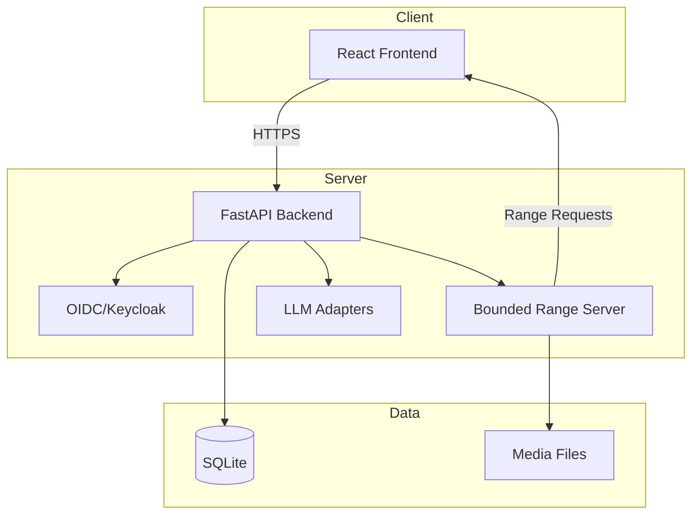

# atlas-forge-145-alan-vo

> Work in progress. This checkpoint may be incomplete or fail tests. See PLAN.md and STATUS.md before use.


**Alan Vo | AI & Machine Learning**

An AI/ML developer tool for programmatic video composition and rendering. Write HTML. Render video. Built for agents.

## Problem

Video composition workflows often involve splitting a single long recording into many trimmed segments, each rendered as a separate `<video>` element pointing to the same source file. Browsers open HTTP/1.1 connections for each media element and hold them open while buffering. With more than ~6 video elements on the same host, Chrome's 6-connection limit starves subsequent requests, causing hangs in tools like `hyperframes check` and unbounded memory growth in preview tabs.

## Solution

This application implements a bounded media range server that caps open-ended `Range: bytes=N-` requests at a configurable piece size (default 4 MB). Each response completes and frees its connection, allowing browsers to request subsequent pieces as needed for playback and seeking. This fixes the connection starvation issue described in [hyperframes#6029](https://github.com/heygen-com/hyperframes/issues/6029).

## Features

- **Bounded media range responses** - Open-ended range requests capped at 4 MB (configurable), fixing connection starvation
- **OIDC authentication with Keycloak** - Authorization code flow with PKCE, role-based access control (admin/analyst/viewer)
- **LLM provider adapters** - Unified interface for OpenAI-compatible, Anthropic, Gemini, and Ollama providers
- **Video composition & rendering** - Programmatic video composition from HTML templates
- **React + TypeScript frontend** - Responsive UI with health monitoring and feature overview
- **Docker Compose deployment** - Single-command startup with persistent volumes

## Architecture



## Quick Start

### Prerequisites

- Docker and Docker Compose
- Node.js 24+ (for frontend development)
- Python 3.12+ (for backend development)

### Using Docker Compose (Recommended)

```bash
# Clone and navigate
cd atlas-forge-145-alan-vo

# Copy environment template
cp .env.example .env

# Start all services
docker compose up --build

# Access:
# Frontend: http://localhost
# Backend API: http://localhost:8000
# Keycloak: http://localhost:8080 (admin/admin)
```

### Local Development

**Backend:**
```bash
cd backend
python3 -m venv .venv
source .venv/bin/activate
pip install -r requirements.txt
cp ../.env.example .env
python -m app.main
```

**Frontend:**
```bash
cd frontend
npm install
npm run dev
```

## API Endpoints

### Health
- `GET /api/health` - Service health check

### Media
- `GET /api/media/{path}` - Serve media files with bounded range support
  - Supports `Range: bytes=start-end`, `Range: bytes=start-`, `Range: bytes=-suffix`
  - Open-ended ranges capped at `MEDIA_RANGE_PIECE_BYTES` (default 4 MB)
  - Returns `206 Partial Content` with `Content-Range` header

### Authentication (Placeholder)
- `GET /api/auth/login` - Initiate OIDC login
- `POST /api/auth/callback` - Handle OIDC callback
- `POST /api/auth/logout` - Logout
- `GET /api/auth/me` - Get current user info

## Configuration

| Variable | Default | Description |
|----------|---------|-------------|
| `DATABASE_URL` | `sqlite+aiosqlite:///./data/app.db` | Database connection string |
| `KEYCLOAK_URL` | `http://localhost:8080` | Keycloak server URL |
| `KEYCLOAK_REALM` | `atlas-forge` | Keycloak realm |
| `KEYCLOAK_CLIENT_ID` | `atlas-forge-client` | OIDC client ID |
| `KEYCLOAK_CLIENT_SECRET` | *(required)* | OIDC client secret |
| `OIDC_ISSUER` | `http://localhost:8080/realms/atlas-forge` | OIDC issuer URL |
| `OIDC_AUDIENCE` | `atlas-forge-client` | OIDC audience |
| `LLM_PROVIDER` | `openai-compatible` | LLM provider type |
| `LLM_MODEL` | `gpt-4o-mini` | LLM model name |
| `LLM_BASE_URL` | *(optional)* | Custom LLM base URL |
| `LLM_API_KEY` | *(required for LLM)* | LLM API key |
| `CORS_ORIGINS` | `http://localhost:5173,http://localhost` | Allowed CORS origins |
| `MEDIA_RANGE_PIECE_BYTES` | `4194304` | Max bytes per range response (4 MB) |

## AI/ML Evaluation

This product addresses the connection starvation problem in multi-video compositions through bounded range responses. The evaluation approach:

1. **Reproducible test**: Create a composition with 8+ `<video>` elements from the same source file
2. **Baseline**: Unbounded range responses (original hyperframes behavior) - hangs at ~6 videos
3. **Measurement**: With 4 MB cap, all videos load and play without connection starvation
4. **Command**: `docker compose up && curl -H "Range: bytes=0-" http://localhost:8000/api/media/test.mp4`

**Limitations**: This is a transport-layer fix. It does not address codec compatibility, adaptive bitrate streaming, or client-side buffering strategies. For production video delivery, consider a dedicated media server (e.g., nginx with ngx_http_mp4_module, or a streaming platform).

## Security Limitations

- **Demo mode**: Keycloak runs with default admin/admin credentials. Change in production.
- **SQLite**: Single-file database suitable for development. Use PostgreSQL for production.
- **TLS**: Reverse proxy (nginx, Traefik, Caddy) required for HTTPS in production.
- **Secrets**: All secrets via environment variables. Never commit `.env` files.
- **LLM keys**: Only server-side. Never exposed to frontend.

## Provider Configuration

| Provider | Base URL | Models | Notes |
|----------|----------|--------|-------|
| OpenAI | `https://api.openai.com/v1` | gpt-4o, gpt-4o-mini | Default |
| Anthropic | `https://api.anthropic.com` | claude-3-5-sonnet | Messages API |
| Gemini | `https://generativelanguage.googleapis.com` | gemini-1.5-pro | generateContent |
| Ollama | `http://localhost:11434` | llama3, mistral | Local inference |
| LiteLLM | Custom | Any | OpenAI-compatible proxy |
| OpenRouter | `https://openrouter.ai/api/v1` | Any | Multi-provider gateway |

## SSO/SAML Setup

Keycloak supports SAML 2.0 identity brokering:

1. Configure SAML IdP in Keycloak Admin Console → Identity Providers → SAML v2.0
2. Import IdP metadata or configure manually
3. Map SAML attributes to Keycloak user attributes
4. Enable "First Login Flow" for user registration

## Backup & Restore

```bash
# Backup
docker compose exec backend cp /app/data/app.db /app/data/app.db.backup
docker compose cp atlas-forge-backend:/app/data/app.db ./backup/app.db

# Restore
docker compose cp ./backup/app.db atlas-forge-backend:/app/data/app.db
docker compose restart backend
```

## Development

### Running Tests

```bash
# Backend tests
cd backend
source .venv/bin/activate
PYTHONPATH=. python -m pytest app/tests -v

# Frontend tests
cd frontend
npm test
```

### Code Quality

```bash
# Backend
cd backend && source .venv/bin/activate
python -m py_compile app/**/*.py

# Frontend
cd frontend && npm run build
```

## Changelog

See [CHANGELOG.md](CHANGELOG.md) for release history.

## License

MIT License - Copyright (c) 2024 Alan Vo <alanvo@gmail.com>

See [LICENSE](LICENSE) for details.
